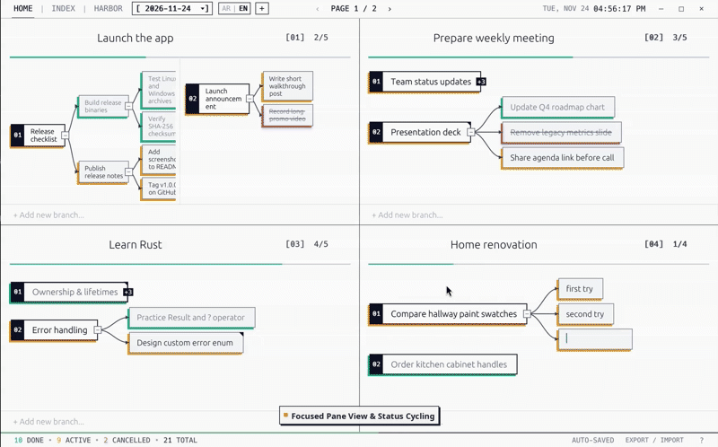
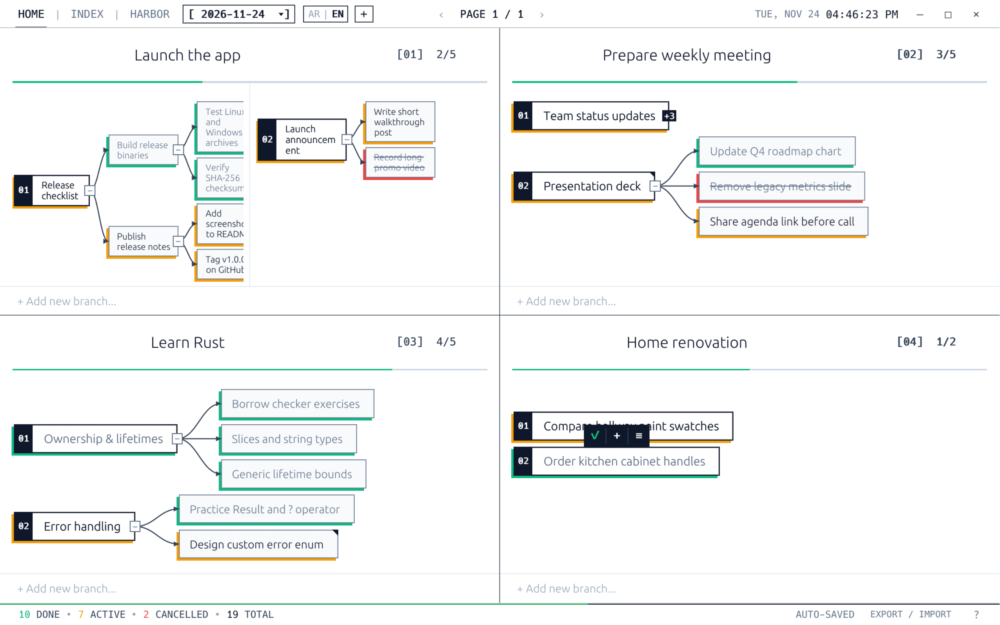
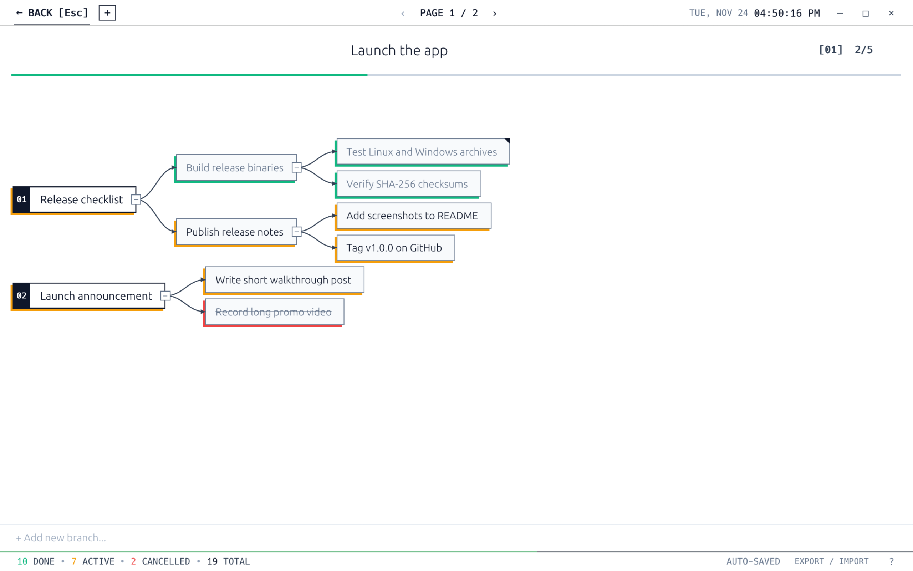
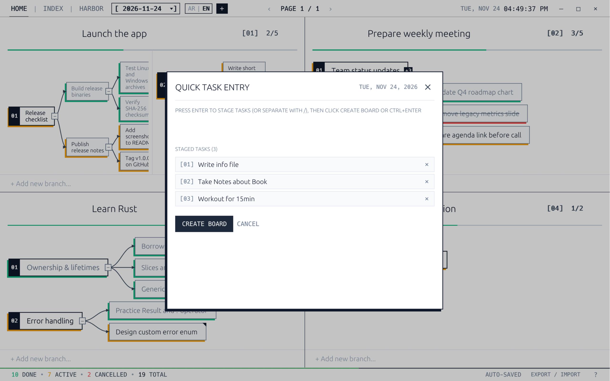
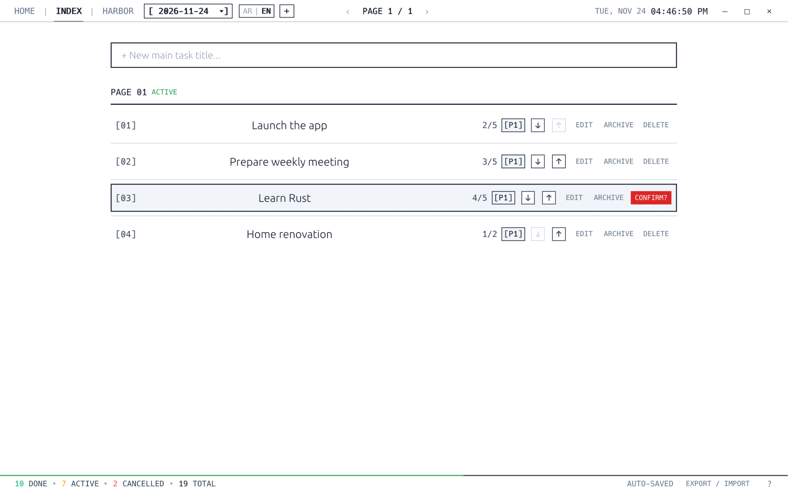
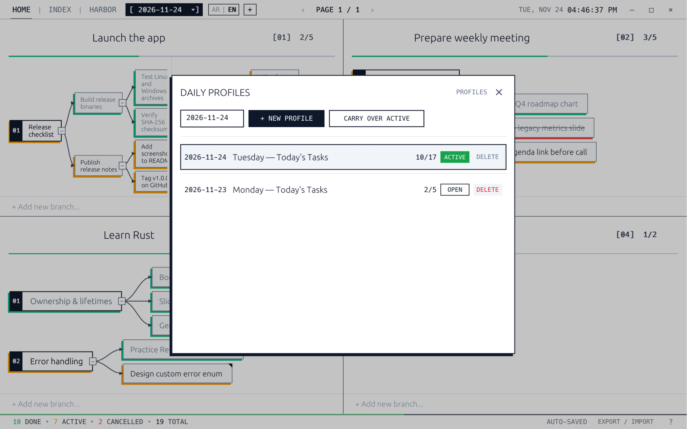
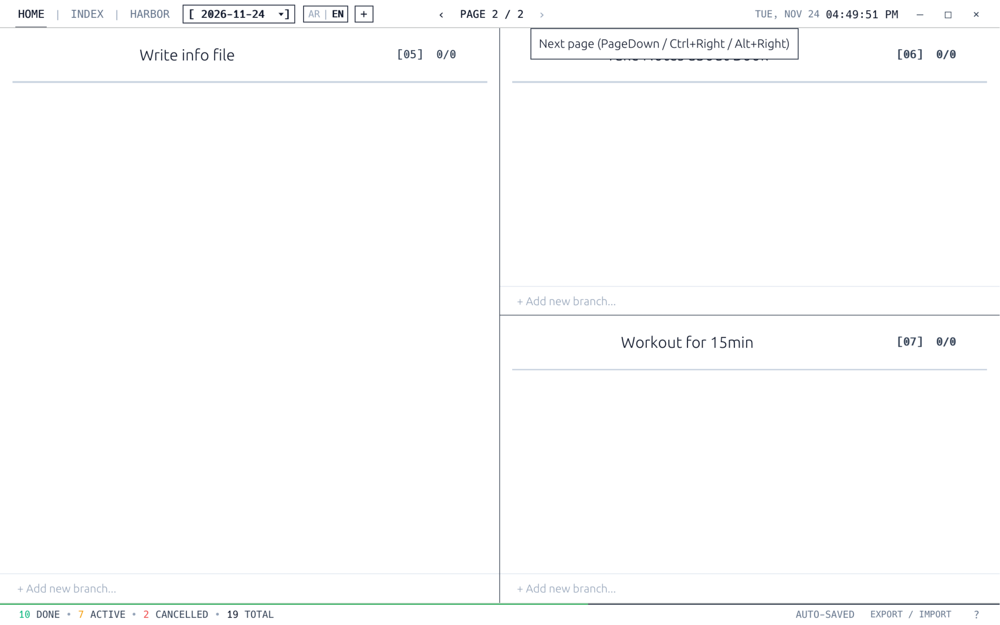

# Whiteboard Tracker

A fast, lightweight, local-first desktop task and mind-map tracker built in Rust with `eframe`/`egui`. Designed with a Swiss-grid architectural aesthetic, Whiteboard Tracker turns your screen into a paginated 4-pane daily whiteboard with nested horizontal mind-map trees, inline notes, daily profiles, and first-class bilingual **English (LTR)** and **Arabic (RTL)** support.

---

## Screenshots

<p align="center">
  
  <br />
  <a href="docs/screenshots/demo.mp4"><strong>Watch the full demo (1:40)</strong></a>
</p>

### Daily Whiteboard Overview


*Paginated 4-pane Swiss-grid workspace (`HOME`) with multi-level mind-map trees, folded branches (`+3`), status shadows, dog-ear note indicators, and live progress metrics.*

| Focus Mode | Quick Task Entry |
| :---: | :---: |
|  |  |
| *Maximize any single pane to full screen (`1`–`9` or click header; `Esc` to return).* | *Rapidly stage multiple main tasks (`Ctrl+N`) before generating panes on the board.* |

| Master Index | Daily Profiles & Carry-Over |
| :---: | :---: |
|  |  |
| *Reorder panes across pages, inline-rename, archive, or delete with two-click confirmation.* | *Switch between chronological daily boards and carry over unfinished active tasks.* |

### Multi-Page Pagination


*Boards automatically paginate at 4 panes per page with instant keyboard navigation (`PageUp` / `PageDown`, `Alt+←` / `Alt+→`).*

---

## Features

- **Paginated Swiss-Grid Tiling Board (`HOME`)**: Auto-tiles up to 4 main task panes per page (1 full, 2 split, 3 master+stack, 4 in a 2×2 grid) with Focus Mode (single maximized pane) and Zen Mode (distraction-free board).
- **Horizontal Mind-Map Outlining**: Add arbitrarily nested subtasks with Bezier branch connectors, collapsible branches (`[−]` / `[+N]`), auto-splitting dense panes into 2 balanced columns, and zero-friction keyboard outlining (`Enter` / `Tab` / `Shift+Tab`).
- **Tri-State Execution System**: Track every task as **Active** (amber), **Completed** (emerald), or **Cancelled** (red strikethrough). Leaf-only progress bars exclude cancelled items from the denominator. Supports `Ctrl+Click` and drag-box lasso multi-selection.
- **Embedded Paper Note Drawer**: Single-click any task card (or press `N` / `Ctrl+Enter`) to open a split note drawer inside its pane with one-click copy and full RTL/LTR multiline editing.
- **Bilingual Arabic (RTL) & English (LTR) UI**: Live `AR | EN` switcher that mirrors layouts, alignment, progress bars, and navigation; includes proper Arabic glyph shaping, Unicode bidi reordering, and a bundled `NotoSansArabic-Regular.ttf` fallback font.
- **Daily Profiles & Carry-Over**: Maintain chronological daily boards (`YYYY-MM-DD`), create boards for any date, and carry over only unfinished active tasks from the previous profile without duplication.
- **Master Index (`INDEX`) & Archive (`HARBOR`)**: Reorder main panes across pages, inline-rename, archive finished panes to Harbor, search archived panes/subtasks/notes, and restore or permanently delete with two-click confirmation.
- **Safe Local-First Persistence & Export/Import**: Debounced atomic auto-saves (`data.tmp` → `data.json`), automatic timestamped `.bak` backups on parse errors or before imports, full JSON backup export/import, per-day Markdown export, and a 30-step undo stack (`Ctrl+Z`).

See [ROADMAP.md](ROADMAP.md) for planned future features (dark mode, cloud backup, AI client integration).

---

## Installation

Prebuilt binaries are published on the GitHub Releases page.

### Linux

- **Fedora / RHEL / openSUSE (`.rpm`)**:
  ```bash
  sudo dnf install ./whiteboard_tracker-*.rpm
  ```
- **Prebuilt Binary (Other Distros)**:
  1. Download and extract the Linux archive from GitHub Releases.
  2. Make the binary executable and run it:
     ```bash
     chmod +x whiteboard_tracker
     ./whiteboard_tracker
     ```
  3. *(Optional)* Install the desktop entry and icon from `packaging/whiteboard_tracker.desktop` and `packaging/whiteboard_tracker.svg`.
  4. *(Optional)* Native Export/Import file dialogs on Linux use `zenity` or `kdialog`; install one of them if not already present on your system.

### Windows

1. Download the Windows release `.zip` (or `.exe`) from GitHub Releases and extract it.
2. Run `whiteboard_tracker.exe`.

> **Unsigned Build Warning (Windows Defender SmartScreen):**
> Windows release builds are currently **unsigned**. On first launch, Windows will display a blue **"Windows protected your PC"** dialog stating *"Microsoft Defender SmartScreen prevented an unrecognized app from starting"*.
> To run the app, click **More info** → **Run anyway**.

### macOS

1. Download the macOS release archive from GitHub Releases and extract it.
2. Launch `Whiteboard Tracker` (or run `./whiteboard_tracker`).

> **Unsigned Build Warning (macOS Gatekeeper):**
> macOS release builds are currently **unsigned and not notarized**. On first launch, macOS Gatekeeper will block it with a warning such as ***"whiteboard_tracker" cannot be opened because the developer cannot be verified*** (or *"Apple could not verify "whiteboard_tracker" is free of malware"* on newer macOS versions).
> To open the app:
> - **Option 1 (Finder):** Right-click (Control-click) the app/binary → select **Open** → click **Open** in the dialog. On macOS Sequoia and later, open **System Settings → Privacy & Security**, scroll down, and click **Open Anyway**.
> - **Option 2 (Terminal):** Clear the quarantine attribute once:
>   ```bash
>   xattr -dr com.apple.quarantine /path/to/whiteboard_tracker
>   ```

---

## Build from Source

### Prerequisites

- **Rust** (stable toolchain, 2021 edition) via [rustup](https://rustup.rs/).
- **Linux system libraries** (for OpenGL / X11 / Wayland windowing):
  - **Fedora**: `sudo dnf install gcc mesa-libGL-devel libxcb-devel libxkbcommon-devel`
  - **Debian / Ubuntu**: `sudo apt install build-essential libgl1-mesa-dev libxcb-render0-dev libxcb-shape0-dev libxcb-xfixes0-dev libxkbcommon-dev`
  - *(Optional on Linux)* `zenity` or `kdialog` for native file open/save dialogs.

### Compile & Run

```bash
git clone https://github.com/<owner>/whiteboard_tracker.git
cd whiteboard_tracker
cargo build --release
./target/release/whiteboard_tracker
```

Run the test suite:

```bash
cargo test
```

*(Optional, Fedora)* Build an RPM package using [`cargo-generate-rpm`](https://crates.io/crates/cargo-generate-rpm):

```bash
cargo build --release
cargo generate-rpm
```

---

## Data Storage (`data.json`)

All daily profiles, tasks, notes, archived panes, and language preferences are stored locally in a single pretty-printed JSON file using `dirs::data_local_dir()`:

| OS | Default Path |
| :--- | :--- |
| **Linux** | `~/.local/share/whiteboard_tracker/data.json` (or `$XDG_DATA_HOME/whiteboard_tracker/data.json`) |
| **macOS** | `~/Library/Application Support/whiteboard_tracker/data.json` |
| **Windows** | `%LOCALAPPDATA%\whiteboard_tracker\data.json` |

- If the OS data directory cannot be resolved, it falls back to `./.whiteboard_tracker/data.json`.
- Saves are written atomically via `data.tmp` and renamed to `data.json`.
- If `data.json` ever fails to parse on startup, or before you confirm a JSON import, a unique timestamped `.bak` copy is created in the same folder so data is never silently overwritten.
- You can export all data as JSON, import a JSON backup, or export the active day as Markdown from the **Export / Import** button in the bottom status bar.

---

## Keyboard Shortcuts

On macOS, use `Cmd` in place of `Ctrl`.

| Context | Shortcut | Action |
| :--- | :--- | :--- |
| **Global** | `Ctrl+N` | Open Quick Task Entry modal |
| **Global** | `Ctrl+Z` | Undo last board/archive change (up to 30 steps) |
| **Global** | `Ctrl+H` | Toggle Zen Mode (hide top/bottom bars) |
| **Global** | `Ctrl+Q` | Save and quit |
| **Global** | `Esc` | Close active modal / cancel inline edit / close note drawer / exit Zen or Focus mode / clear selection |
| **Board (`HOME`)** | `PageUp` / `Alt+←` / `Ctrl+←`\* | Previous page |
| **Board (`HOME`)** | `PageDown` / `Alt+→` / `Ctrl+→`\* | Next page |
| **Board (`HOME`)** | `Alt+1`–`Alt+9` (or `1`–`9` with no selection) | Toggle Focus Mode for pane 1–9 |
| **Selected Card(s)** | `1` / `2` / `3` | Set status: `1` Active, `2` Completed, `3` Cancelled |
| **Selected / Focused Card** | `Space` | Cycle status (`Active → Completed → Cancelled`) |
| **Selected / Focused Card** | `N` or `Ctrl+Enter` | Open and focus the inline Note Drawer |
| **Focused / Editing Card** | `Enter` | Add sibling task below |
| **Focused / Editing Card** | `Tab` | Add nested child branch |
| **Focused / Editing Card** | `Shift+Tab` | Outdent task one level |
| **Focused Card** | `Delete` / `Backspace` | Delete task node |
| **Mouse (`HOME`)** | Single-click / Double-click card | Open Note Drawer / Inline edit title |
| **Mouse (`HOME`)** | `Ctrl+Click` or Drag on canvas | Multi-select / lasso select cards and pane headers |
| **Quick Entry Modal** | `Enter` | Stage task(s) (splits on `/`) |
| **Quick Entry Modal** | `Ctrl+Enter` | Create board panes from staged tasks |
| **Master Index (`INDEX`)** | `↑` / `↓` | Reorder selected pane up or down across pages |
| **Master Index (`INDEX`)** | `F2` (or double-click title) | Inline rename selected pane |
| **Master Index (`INDEX`)** | `Enter` | Jump to selected pane's page on `HOME` |

*\* `Ctrl+←` / `Ctrl+→` flip pages only when no text input has focus so word-by-word cursor navigation works normally while typing.*

---

## نبذة بالعربية
Whiteboard Tracker — سبورة بيضاء ذكية لترتيب مهامك وخرائطك الذهنية بسرعة وهدوء

تطبيق سطح مكتب خفيف وسريع (حجمه أقل من 20 ميجابايت)، مبني بلغة Rust ومكتبة egui بأسلوب التصميم السويسري الهادئ (Swiss Minimalism) ليبعدك عن التشتيت ويعطيك صورة كاملة ليومك من نظرة واحدة.

أبرز الميزات:
• تقسيم تلقائي للشاشة: اكتب مهام يومك دفعة واحدة، ويوزعها التطبيق تلقائياً على الشاشة (4 لوحات لكل صفحة مع فتح صفحات جديدة تلقائياً).
• خرائط ذهنية لكل مهمة: فرّع أي مهمة إلى مهام أصغر بلا حدود مع طيّ الفروع وتتبّع نسبة الإنجاز لكل لوحة.
• بروفايلات يومية: كل يوم له مساحته الخاصة مع إمكانية ترحيل المهام غير المكتملة لليوم التالي بضغطة واحدة.
• وضع التركيز والملاحظات: كبّر أي مهمة مع تفرعاتها، وأضف ملاحظات نصية لأي فرع، مع فهرس شامل لإعادة الترتيب وحفظ تلقائي وتراجع (Ctrl+Z).
• دعم كامل للعربية والإنجليزية: واجهة ثنائية اللغة تنعكس بالكامل بين اليمين واليسار (RTL / LTR).
• جاهز للتثبيت: حزم تثبيت مباشرة لأنظمة Fedora و Ubuntu و Windows.

القادم في التحديثات المقبلة: الوضع الليلي (Dark Mode)، النسخ الاحتياطي السحابي، والربط المباشر مع مساعد الذكاء الاصطناعي الخاص بك.

يسعدني جداً سماع آرائكم ومقترحاتكم بعد التجربة!

---

## License

- Application source code is licensed under the **MIT License** — see [LICENSE](LICENSE).
- The bundled Arabic fallback font (`assets/NotoSansArabic-Regular.ttf`) is licensed under the **SIL Open Font License 1.1** — see [assets/OFL.txt](assets/OFL.txt).
